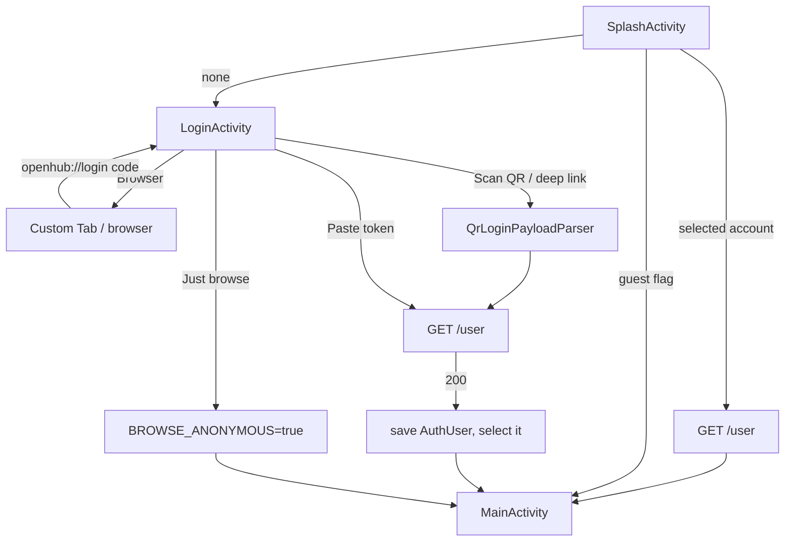

# OpenHubX — architecture

## Stack

| Part | Choice |
|---|---|
| Language | Java only, language level 21, core library desugaring (`desugar_jdk_libs` 2.1.5) |
| Build | AGP 9.2.0, Gradle 9.7.1 (daemon on JDK 25), compileSdk 37, targetSdk 34, minSdk 21 |
| UI | AndroidX, Material Components (Bridge themes), ViewBinding, CardView, Custom Tabs |
| Pattern | MVP: `ui/` views, `mvp/presenter/` presenters, `mvp/contract/` interfaces |
| DI | Dagger 2.51.1 (`inject/`) |
| Data | Room 2.6.1, database v8 (`dao/`), `DaoSession` wrapper keeps the old greenDAO-style API |
| Network | Retrofit 2.11 + OkHttp, RxJava 3 + RxAndroid 3 |
| QR | ZXing (`zxing-android-embedded`) on the phone; vendored `qrcode-generator` (MIT) in laptop tools |
| Other | Glide 4.16, EventBus, jsoup (trending/topics pages), material-about-library 3.1.2 |

## App flow

`BaseActivity.onCreate` sends any screen with no signed-in user back to Splash,
except Splash, Login, and guest mode (where that would loop).

## Auth model

- Accounts are rows in `AUTH_USER`: access token, scope, auth time, expiry, `SELECTED`,
  login id, name, avatar, and (v8) `TOKEN_TYPE`, `REFRESH_TOKEN`, `REFRESH_EXPIRES_AT`, `CLIENT_ID`.
- `AppData.INSTANCE` holds the current `AuthUser` and `User` in memory.
- Token types: `null` = browser OAuth; `pat`, `oauth`, `ghapp` = imported (token or QR).
- `GhAppTokenRefresher` renews `ghapp` tokens with `client_id` + `refresh_token` only
  (device-flow tokens need no client secret).
- Guest mode is the pref `PrefUtils.BROWSE_ANONYMOUS` with no `AuthUser`. Requests then send
  no `Authorization` header (`AppData.getAccessToken()` returns null).
- Switch account: `clearAllSelected` + `setSelectedByLoginId`, clear `AppData`, restart.
  Logout: delete the current `AUTH_USER` row only.

## Data

Room database v8, migrations 2→3→…→8 in `dao/Migrations.java`.

| Table | Job |
|---|---|
| `AUTH_USER` | Signed-in accounts |
| `BOOKMARK` | Bookmarks; `OWNER_LOGIN_ID` (v6) scopes each row to one account |
| `LOCAL_REPO`, `LOCAL_USER` | Copies of bookmarked/traced repos and users, so lists load offline |
| `TRACE`, `TRACE_REPO`, `TRACE_USER` | Recently viewed |
| `SEARCH_HISTORY` (v7) | Per-type search history |
| `MY_TRENDING_LANGUAGE` | Chosen trending languages |
| `BOOK_MARK_REPO`, `BOOK_MARK_USER` | Legacy, kept for migration only |

Every bookmark read and write passes the current login as `owner`
(`BookmarkDao.loadPaged(owner, …)`, `findOneByRepoId(id, owner)`, …).

## Network and errors

`AppRetrofit.BaseInterceptor` adds `uniqueLoginId` to URLs (separate caches per account),
refreshes `ghapp` tokens, adds `Authorization: token …`, and applies cache-first rules.

`BasePresenter.generalRxHttpExecute` maps non-2xx responses:

| Code | Error | Shown as |
|---|---|---|
| 401 | `UnauthorizedError` | Toast, account removed, login screen |
| 403 | `HttpForbiddenError` | `ListFragment.showLoadHint` (message, no retry) |
| 404 | `HttpPageNoFoundError` | Empty list |
| 422 | Exception | "Invalid query" |
| 504 | `HttpError(NO_CACHE_AND_NETWORK)` | Retry tip |
| other | Exception | "Request failed: HTTP <code>" |

## UI shells

- `MainActivity` (extends `BaseDrawerActivity`): bottom bar + three cards
  (`content_main.xml`). The old side drawer still exists but is hidden by the bar.
- `LoginActivity` + `activity_login_new.xml`: list rows styled by `LoginList*` styles.
- `SearchActivity` + `activity_search_pager.xml`: results pager plus a bottom input panel,
  `windowSoftInputMode="adjustResize"`.
- `ListFragment`: shared list with refresh, load more, error tip (`showLoadError`) and
  hint (`showLoadHint`).

## Android platform rules that bit us

| Rule | Where it is handled |
|---|---|
| Android 11+ hides other apps unless declared | `<queries>` for https `VIEW`/`BROWSABLE` and `CustomTabsService` in the manifest |
| Android 12+ requires a mutability flag on `PendingIntent` | `AppOpener`: `FLAG_MUTABLE` for the Custom Tabs share/copy items (the browser fills in the URL) |
| `MaterialCardView` needs a MaterialComponents theme | All four app themes extend `Theme.MaterialComponents.Light.NoActionBar.Bridge` |
| HTTP/2 has no reason phrase | Errors use the status code, never `response.message()` alone |

## Build

| Item | Value |
|---|---|
| Flavors | `normal` ("OpenHubX"), `fullName` ("OpenHubX for GitHub") |
| Build types | `debug`; `release` (R8 + `shrinkResources`, legacy resource shrinker); `e2e` (debug + `.e2e` app id; device tests use it only with `-Pe2e`) |
| Version | `2026.MM.NNN` in `gradle.properties`; each publish: NNN += random 1–10, versionCode += 1 |
| Signing | `~/.android-keystores/openhubx-release.jks`, creds in git-ignored `local.properties` |
| Release APK | ~4.4 MB (normal) |
| CI | `.github/workflows/debug-apk.yml`: debug APK + unit tests on each push |

## Repo map

| Path | Holds |
|---|---|
| `app/` | The Android app |
| `third_party/maven/` | jcenter-only artifacts, vendored |
| `third_party/dataautoaccess/` | DataAutoAccess (Apache-2.0), imported as source |
| `tools/` | QR generator, OAuth helper, userscripts, e2e runner |
| `docs/` | Developer guides |
| `vibes/` | These specs |
